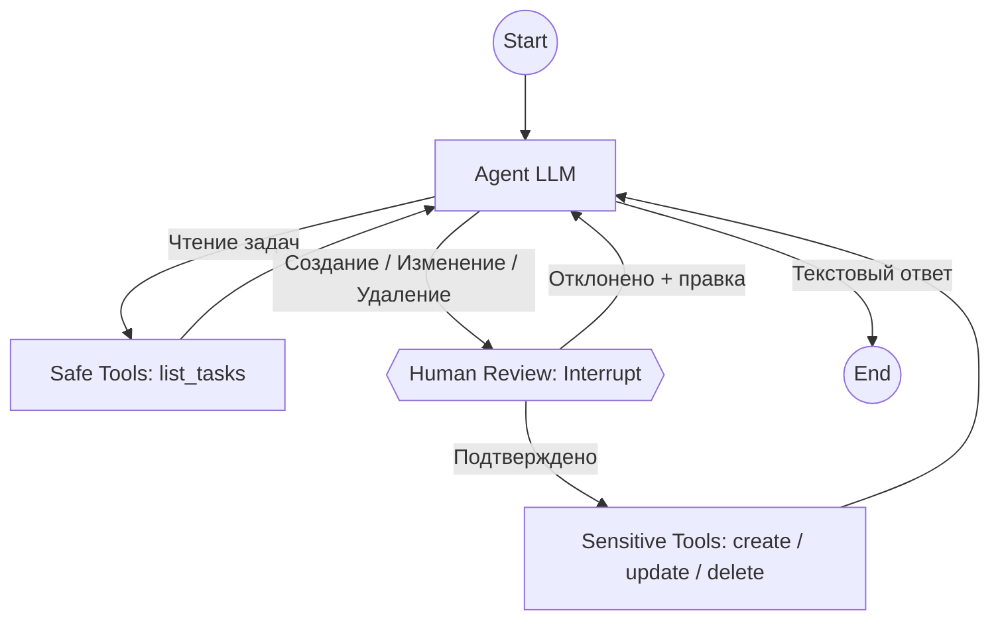

## Персональный AI-менеджер задач с **Human-in-the-loop (HITL)** подтверждением действий, локальной LLM и синхронизацией между **Telegram-ботом** и **веб-дашбордом на Streamlit**

---

## Ключевые особенности

- **Human-in-the-loop (LangGraph `interrupt` + `Command`):** безопасные операции (чтение задач) выполняются сразу, а создание, изменение и удаление ставят граф на паузу и ждут подтверждения пользователя (или текстовой правки на лету).
- **Персистентность (`SqliteSaver`):** состояние диалога и точка паузы сохраняются на диск — бот помнит контекст и ждёт подтверждения даже после перезапуска.
- **Синхронизация Telegram ↔ Web:** общая база SQLite в режиме `WAL` для одновременной работы обоих интерфейсов.
- **Изоляция пользователей и личная нумерация:** привязка веб-профиля к Telegram через секретный код (`/code`), скрытый проброс `user_id` в инструменты через `RunnableConfig` и независимая нумерация задач (`№1, №2, №3...`) для каждого пользователя.
- **Локальный и облачный режимы:** работает локально через Ollama (`qwen2.5`) или через DeepSeek API.

---

## Архитектура графа



---

## Быстрый старт

```bash
git clone https://github.com/DashaStu/Human_in_the_loop.git
cd Human_in_the_loop
python -m venv venv
# Windows: venv\Scripts\activate  |  Linux/macOS: source venv/bin/activate
pip install -r requirements.txt
cp .env.example .env
```
Дальше запускаем локально в двух терминалах
```bash
python bot.py

streamlit run web.py
```
или запускаем через докер
```bash
docker compose up --build
```

Веб-интерфейс будет доступен по http://localhost:8501
